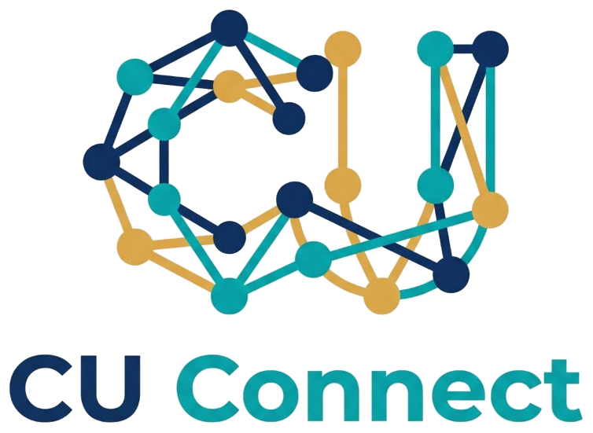
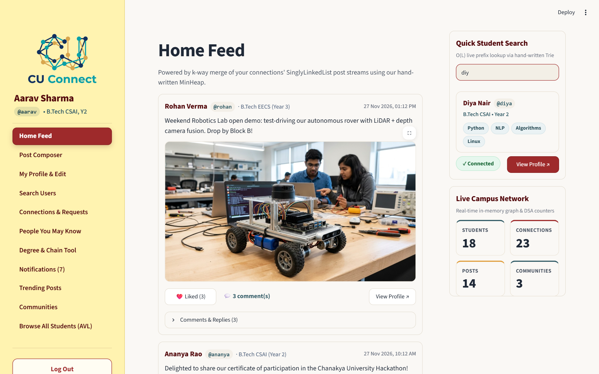

<p align="center">
  
</p>

<h1 align="center">CUConnect — Chanakya University Student Networking Platform</h1>

<p align="center">
  <strong>Course:</strong> Data Structures and Algorithms (<code>EAI212 / EVE203 / EEC203</code>) — III Semester B.Tech., 2026–27<br/>
  <strong>Institution:</strong> Chanakya University, Bangalore — School of Engineering<br/>
  <strong>Faculty Guide:</strong> Prof. Nitish Hegde &nbsp;|&nbsp; <strong>Team:</strong> Dhruv Jha, Pranam Jogur, Nihal N<br/>
  <strong>Repository:</strong> <a href="https://github.com/dhruvjha18jee-star/CUConnect">https://github.com/dhruvjha18jee-star/CUConnect</a>
</p>

---

## Overview

**CUConnect** is a student networking platform where Chanakya University students share technical projects and image updates, connect across departments, and discover collaborators. Every core engine feature is powered by **hand-written Python 3.11 data structures and algorithms** implemented strictly using the Python standard library — with **zero** third-party graph/container libraries (`networkx`, `heapq`, `collections.deque`, `sortedcontainers`) and **zero** graph logic in SQL.

<p align="center">
  
</p>

### Hand-Written Data Structures (`core/ds/`)
- **`HashTable`** (`hash_table.py`): separate chaining, base-31 polynomial rolling hash (no built-in `hash()`), automatic 2× resize & rehash when load factor exceeds `0.75`.
- **`SinglyLinkedList`** (`linked_list.py`): $O(1)$ newest-at-head insertion for per-user text & image post streams.
- **`Queue`** (`queue_ds.py`): linked-list FIFO queue with $O(1)$ `enqueue`/`dequeue` and safe `remove_value` (maintaining `_tail`) for out-of-order connection requests, BFS frontier, and notifications.
- **`Stack`** (`stack.py`): linked-node LIFO stack for reversible Undo history, console back-navigation, Trie branch pruning, and iterative DFS communities.
- **`MinHeap`** (`heap.py`): array-based binary heap with `key` function (supports Max-Heap) and deterministic `(priority, counter, item)` tie-breaking for k-way feed merge, Jaccard suggestions, and trending posts.
- **`Trie`** (`trie.py`): prefix tree with compact `HashTable` child maps for $O(L)$ live user search over usernames and full-name words.
- **`AVLTree`** (`avl_tree.py`): self-balancing BST with explicit **LL, RR, LR, RL** rotations powering the alphabetical student directory.
- **`merge_sort` & `binary_search`** (`algorithms.py`): stable $O(n \log n)$ divide-and-conquer sort and $O(\log d)$ edge membership check on sorted adjacency lists.

### Highlights & All 7 Enhancements Implemented
1. **Image Posts** (`Post.image_path` + `ui/uploads/` + demo Robotics Lab rover & Hackathon certificate posts) alongside text posts.
2. **Notifications Queue** (`core/notifications.py`): per-user FIFO Queue with live unread counts and $O(1)$ `mark_read`.
3. **Likes & Threaded Comment Trees** (`core/engagement.py`): per-post nested `HashTable` likes ($O(1)$) and n-ary Comment Trees rendered via **Pre-Order DFS**.
4. **Trending Posts** (`core/engagement.py`): recent 7-day posts scored by `likes + 2 × comments` with linked-list early exit and `MinHeap` top-$k$ extraction.
5. **Undo & Back-Navigation Stack** (`core/service.py`): reversible `send_request` / `remove_connection` Undo Stack plus `ScreenNavigator` for Console CLI.
6. **Student Communities** (`core/communities.py`): connected components computed via **Iterative DFS + `Stack`**.
7. **Alphabetical Student Directory** (`core/ds/avl_tree.py`): self-balancing **AVL Tree** (`height = 5` for 18 seeded students, $O(V)$ A–Z in-order walk).

---

## Quick Start (From a Clean Checkout)

### 1. Create a Virtual Environment and Install Dependencies
```powershell
python -m venv .venv
.\.venv\Scripts\pip.exe install -r requirements.txt
```
*(On Linux/macOS, replace `.\.venv\Scripts\` with `.venv/bin/`.)*

> **Note**: The core engine (`core/` and `storage/`) requires **only Python 3.10+ standard library**. Third-party packages in `requirements.txt` are used strictly for the Streamlit UI, pytest test runner, charts, and document/PDF generation scripts.

### 2. Seed the Demo Campus Database (18 Students, 23 Connections, 14 Posts, 3 Communities)
```powershell
.\.venv\Scripts\python.exe scripts/seed_data.py
```
Demo login credentials for any seeded student (e.g., `aarav`, `diya`, `rohan`, `meera`, `kabir`, `pranav`):
- **Username**: `aarav`
- **Password**: `chanakya2026`

### 3. Run the Redesigned Streamlit Web App
```powershell
.\.venv\Scripts\streamlit.exe run ui/streamlit_app.py
```
Open the URL printed in the terminal (usually `http://localhost:8501`).

### 4. Run the Console CLI App (with Stack Back-Navigation)
```powershell
.\.venv\Scripts\python.exe ui/console_app.py
```
*(Pass `--db path/to/file.db` to use a custom SQLite database file.)*

---

## Running Tests, Rule Checks & Benchmarks

```powershell
# Run all 50 unit, randomized cross-check, restart-persistence, and end-to-end tests
.\.venv\Scripts\pytest.exe -v

# Verify all hard DSA rules via AST (stdlib-only core, no sorted()/heapq/deque, no graph SQL, Big-O docstrings)
.\.venv\Scripts\python.exe scripts/check_rules.py

# Run empirical benchmarks on 100, 1,000, and 5,000 synthetic users and regenerate benchmark_chart.png
.\.venv\Scripts\python.exe scripts/benchmark.py
```

---

## Repository Layout

```text
README.md
requirements.txt
.streamlit/
  config.toml                     # Vanilla (#FFF3B0) & Auburn (#9E2A2B) Chanakya University theme
core/
  ds/
    hash_table.py                 # Separate-chaining HashTable (polynomial rolling hash, resize > 0.75)
    linked_list.py                # SinglyLinkedList (O(1) head insert, delete_by_id, traverse)
    queue_ds.py                   # Linked-list Queue (O(1) enqueue/dequeue, remove_value)
    stack.py                      # Linked-node LIFO Stack (undo, console nav, iterative DFS)
    heap.py                       # Array-based MinHeap with key fn + deterministic counter
    trie.py                       # Prefix Tree (HashTable children) for live user search
    algorithms.py                 # Stable merge_sort and iterative binary_search
    avl_tree.py                   # Self-balancing AVLTree (LL, RR, LR, RL rotations)
  models.py                       # Dataclasses (incl. Post.image_path) & custom exception hierarchy
  auth.py                         # AccountManager (HashTable) + salted PBKDF2-SHA256 + hmac.compare_digest
  graph.py                        # SocialGraph (sorted adjacency lists, mutuals, BFS degree & chain)
  connections.py                  # ConnectionManager (per-user incoming/outgoing Queues + auto-accept)
  posts.py                        # PostManager (per-user SinglyLinkedList, newest at head)
  feed.py                         # FeedEngine (paginated k-way merge with MinHeap)
  suggestions.py                  # SuggestionEngine (Depth-2 BFS + Jaccard + MinHeap)
  search.py                       # UserSearchIndex (Trie indexing usernames & name tokens)
  notifications.py                # NotificationManager (per-user Queue, unread count, mark read)
  engagement.py                   # Likes HashTable, Comment Tree (pre-order DFS), Trending (MinHeap)
  communities.py                  # CommunityDetector (connected components via iterative DFS + Stack)
  service.py                      # CUConnectService facade & ScreenNavigator (single UI entry point)
storage/
  repository.py                   # Storage-only SQLite3 CRUD repository (7 tables, zero graph SQL)
ui/
  console_app.py                  # Menu CLI calling CUConnectService + Stack back-navigation
  streamlit_app.py                # Redesigned 11-view Streamlit dashboard (Quick Search, View Profile, Image Posts)
  assets/                         # CU Connect logo & demo post images (rover demo, hackathon certificate)
tests/                            # 16 test files (50 passing tests incl. E2E & restart persistence)
scripts/
  seed_data.py                    # Seeds 18 realistic students, 3 communities, 14 posts (with images), likes & comments
  benchmark.py                    # Synthetic 100 / 1,000 / 5,000-user benchmarks + Matplotlib chart
  check_rules.py                  # AST verifier for all DSA hard rules
  generate_diagrams.py            # Generates architecture & DSA diagrams in docs/diagrams/
  capture_screenshots.py          # Captures live redesigned Streamlit UI screenshots via Playwright
  build_report.py                 # Generates docs/REPORT.docx and exports 16-page docs/REPORT.pdf
  build_viva_pdfs.py              # Generates docs/VIVA_QUESTIONNAIRE.pdf & docs/10MIN_CODE_EXPLANATION_GUIDE.pdf
  build_ppt.py                    # Generates 34-slide docs/PRESENTATION.pptx
docs/
  REPORT.pdf / REPORT.docx        # 16-page formal Chanakya University project report
  PRESENTATION.pptx               # 34-slide presentation deck with speaker notes
  VIVA_QUESTIONNAIRE.pdf          # 8-page faculty viva questionnaire & model answers
  10MIN_CODE_EXPLANATION_GUIDE.pdf# 6-page timed 10-minute viva code explanation guide
  VIVA_QA.md / CODE_WALKTHROUGH.md / CHEATSHEET.md / DEMO_SCRIPT.md / REQUIREMENTS_TRACE.md / DECISIONS.md
  diagrams/                       # Generated diagrams, benchmark chart, Chanakya logos & redesigned UI screenshots
```
